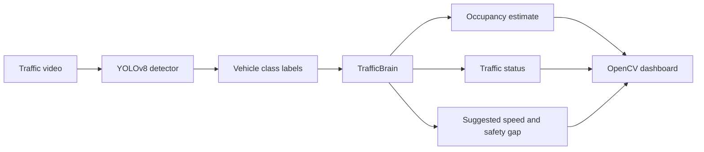

# Traffic Orchestrator

> **Turning traffic video into actionable signals.**

Traffic Orchestrator is a computer-vision proof of concept that analyzes road traffic from ordinary video. It uses **YOLOv8** to detect cars, motorcycles, buses, and trucks, then transforms those detections into a simple traffic dashboard with estimated road occupancy, traffic status, suggested speed, and safety gap.

The project explores how software can extract useful traffic intelligence without requiring sensors in every vehicle or expensive roadside infrastructure.


## Why it matters

Traffic congestion is usually measured through a mixture of fixed sensors, manual observation, and vehicle data. This prototype investigates a more accessible approach: use an existing camera feed to estimate what is happening on the road in real time.

Potential applications include:

- **Early congestion detection** for traffic operators
- **Vehicle-mix monitoring** across cars, motorcycles, buses, and trucks
- **Adaptive speed suggestions** to reduce stop-and-go traffic
- **Traffic dashboards** for cities, campuses, and private sites
- **A foundation for simulation**, including future SUMO integration

The current output is an estimate for experimentation and visualization. It is **not** intended for enforcement, autonomous driving, or safety-critical decisions.

## How it works



1. `main.py` opens the sample video in `data/test_traffic.mp4`.
2. `src/detector.py` loads `yolov8n.pt` and detects selected COCO vehicle classes.
3. `src/brain.py` applies Passenger Car Equivalent values to estimate road occupancy.
4. The dashboard overlays the result on the annotated video.

## Technical highlights

### Real-time visual pipeline

The project connects video capture, neural-network inference, heuristic analysis, and visualization in one small pipeline. This makes the prototype easy to run, inspect, and extend.

### Vehicle-aware occupancy

Different vehicle types contribute differently to estimated road usage:

| Vehicle | COCO class | Relative weight |
| --- | ---: | ---: |
| Car | `2` | `1.0` |
| Motorcycle | `3` | `0.5` |
| Bus | `5` | `2.0` |
| Truck | `7` | `2.0` |

### Interpretable traffic logic

The analysis produces a compact set of signals:

- **Occupancy**: estimated percentage of the configured road capacity
- **Status**: `FLUIDE`, `TRAFIC DENSIFIÉ`, or `EMBOUTEILLAGE DÉTECTÉ`
- **Suggested speed**: a simple congestion-aware recommendation
- **Safety gap**: estimated from speed and a 1.5-second following interval

The formulas are deliberately transparent, so their assumptions can be tested and improved.

## Quick start

### Requirements

- Python 3.9 or newer
- A local graphical display for the OpenCV window
- The included `yolov8n.pt` model, or network access for Ultralytics to download it

### Install

```bash
python -m venv .venv
source .venv/bin/activate        # Windows: .venv\Scripts\activate
python -m pip install -r requirement.txt
```

### Run

```bash
python main.py
```

Press `q` to stop playback. To analyze another video, update `video_path` in `main.py`.

## Project structure

```text
.
├── data/
│   └── test_traffic.mp4       # Sample input video
├── src/
│   ├── brain.py               # Occupancy and traffic heuristics
│   ├── detector.py            # YOLOv8 vehicle detection
│   └── orchestrator.py        # Reserved for future orchestration
├── main.py                    # Video loop and dashboard
├── requirement.txt            # Python dependencies
└── yolov8n.pt                 # YOLOv8 Nano model
```

## What has been achieved

This prototype demonstrates a complete **detection-to-decision visual loop**:

- A video can be processed frame by frame.
- Relevant vehicle categories are detected with a pretrained model.
- Detections are converted into an interpretable occupancy estimate.
- Traffic information is presented immediately through an annotated dashboard.
- The architecture separates detection from traffic reasoning, making both parts replaceable.

That separation is an important technical success: the detector can later be upgraded independently from the traffic model, tracking layer, or simulation connector.

## Current limitations

This project is intentionally experimental. The most important limitations are:

### No persistent vehicle tracking

The detector returns class labels for each frame, not persistent vehicle identities. The same vehicle may therefore be counted repeatedly. Accurate flow, vehicle counts, and speed measurements require tracking such as **ByteTrack** or **BoT-SORT**.

### Simplified occupancy model

The calculation assumes a 150-meter road with four lanes and a fixed seven-meter space contribution per Passenger Car Equivalent. It does not yet account for perspective, lane position, occlusion, camera height, region of interest, or calibrated road geometry.

### No true speed measurement

The displayed speed is a heuristic recommendation based on estimated occupancy. It is not the measured speed of any vehicle and should not be used as a control command.

### Model trade-offs

`yolov8n.pt` is optimized for speed and small size. Distant, partially hidden, unusual, or poorly lit vehicles may be missed. The low confidence threshold improves sensitivity but can also introduce false detections.

### Display dependency

The current application uses `cv2.imshow`, so it expects a desktop display. Headless servers and containers need an output-video or web-dashboard mode.

### Orchestration is not implemented yet

`src/orchestrator.py` is reserved for future routing and simulation logic. Although `networkx` and `traci` appear in the dependency list, they are not currently connected to the running pipeline.

## What we can learn from it

This project offers several practical lessons:

1. **A working end-to-end prototype is valuable early.** Connecting detection, reasoning, and visualization quickly exposes the real engineering gaps.
2. **Detection is not the same as measurement.** Bounding boxes and class labels must be calibrated and tracked before they can support reliable traffic statistics.
3. **Transparent heuristics are useful stepping stones.** Simple formulas make assumptions visible and provide a baseline for later data-driven models.
4. **Context matters as much as the model.** Camera angle, road geometry, frame rate, lighting, and occlusion can matter more than changing the detector alone.
5. **Architecture should leave room for validation.** Separating the detector, traffic brain, and orchestration layer makes it easier to replace assumptions without rewriting the whole application.

## Roadmap

- [ ] Add command-line options for input video and output path
- [ ] Add headless mode that saves an annotated output video
- [ ] Add persistent vehicle tracking and one-time counting
- [ ] Calibrate a region of interest and lane boundaries
- [ ] Move road dimensions and thresholds into configuration
- [ ] Add unit tests for `TrafficBrain`
- [ ] Connect the orchestration layer to SUMO through TraCI
- [ ] Validate estimates against manually labeled traffic footage
- [ ] Add a web or dashboard interface for remote monitoring

## Disclaimer

Traffic Orchestrator is an educational and research prototype. Its estimates depend on uncalibrated assumptions and should not be used for traffic enforcement, autonomous vehicle control, emergency response, or other safety-critical applications.
